# Vault Heist: The Living Vault

**Data Structures Project Report**

| | |
|---|---|
| **Course** | Data Structures |
| **Section** | B |
| **Member 1 (P1, backend)** | 25I-3148 |
| **Member 2 (P2, GUI)** | 25I-3016 |
| **Submission date** | 22.11.26 |

---

## Table of Contents

1. Introduction
2. System Architecture
3. Data Structure Implementation
4. Algorithmic Complexity Analysis
5. Testing
6. Benchmark Results
7. Game and GUI
8. AVL Rotation Demonstrations
9. Heap Demonstrations
10. Work Division
11. Limitations and Future Work
12. Conclusion
- Appendix A: Build and Run
- Appendix B: Viva Preparation
- List of Figures

---

## 1. Introduction

Vault Heist is a GUI puzzle-strategy game. The player is a thief breaking into a vault whose rooms form a tree. Each step through a room raises an alarm meter, so the shape of the tree (its height, balance and ordering) decides whether the player escapes. The game teaches data structures by making the player use them: reading traversals, searching and deleting in a binary search tree (BST), repairing imbalance with AVL rotations, and organising values with a Max Heap and Heap Sort.

The project had three goals:

1. Implement a general binary tree, a BST, an AVL tree and a Max Heap from scratch, without library tree or priority-queue containers.
2. Show every operation as a step-by-step animation driven by events emitted by the model.
3. Keep the data structures independent of the GUI, so they can be unit-tested and benchmarked on their own.

The game has a four-act, twenty-level campaign, an endless survival mode, a sandbox, a local leaderboard, and save and load.

---

## 2. System Architecture

### 2.1 Guiding principle

The model does not know about the GUI. Each operation takes an optional event log. When one is supplied, the operation records what it did as a list of events (visit, compare, insert, unlink, rotate, heap swap and so on). The GUI plays those events back as animation. Because events are plain data, the same mechanism supports undo, replay and hints without duplicating logic.

For one player action the pipeline is:

```
Input -> PlayerAction -> GameSession::apply() -> model operation + EventLog
      -> ActionResult {events, hud} -> AnimationController -> Renderer
```

### 2.2 Layers

| Layer | Folder | Responsibility | Depends on |
|---|---|---|---|
| Contracts | `contracts/` | Event types, fixed-size containers, constants, view snapshot | none |
| Model | `model/` | BinaryTree, BST, AVLTree, MaxHeap, sorts, validator, serializer | contracts |
| Game | `game/` | Level loading and generation, GameSession bridge, scoring, save, leaderboard | model, contracts |
| GUI | `gui/` | SFML screens, widgets, renderer, animation controller | game, contracts |

Only `gui/` includes SFML headers. The model and game layers are plain C++.

### 2.3 Ownership and identifiers

Each tree owns its nodes through a `NodePool`. Every node has a unique integer id equal to its pool index. Ids are never reused and never change, even after rotations or value swaps, so the GUI can follow a node through an animation. Removed nodes are marked dead rather than freed, so undo can restore them. The pool's destructor deletes every node.

The project does not use `std::vector`, `std::map`, smart pointers, templates or `<algorithm>`. Dynamic storage comes from small concrete containers in `contracts/Containers.h` (`IntArray`, `NodePtrArray`, `EventArray`, and stacks and queues built on them). Each is a raw array that doubles when full.

### 2.4 Event model

| Event | Meaning | Visual effect |
|---|---|---|
| VISIT | A room is entered | Node pulses; alarm +1 |
| COMPARE | A key is compared with a room | Arrow shows the chosen direction |
| INSERT, UNLINK | A node is added or removed | Node grows in, or fades out |
| SWAP_VALUE | Two values exchange places | Values slide past each other |
| ROTATE | A rotation is applied | Nodes tween to new positions |
| UPDATE_HEIGHT, UPDATE_SIZE | Metadata changes | Label flickers |
| BALANCE_ALERT | A node is unbalanced | Badge turns red |
| HIGHLIGHT_SUBTREE | A subtree is skipped or reported | Subtree tinted |
| HEAP_BUILD, HEAP_SWAP, HEAPIFY_START, HEAPIFY_DONE | Heap construction and repair | Array and tree cells swap together |
| EXTRACT_MAX, MARK_SORTED, HEAP_SIZE_CHANGE | Heap Sort progress | Maximum moves to the sorted region |
| HEAP_SORT_COMPLETE, DONE | End of a batch | Completion effect |

### 2.5 Undo

Undo uses serialised snapshots. Before each action that changes the structure, the game stores the tree or heap as text, and undo restores the most recent snapshot. We chose snapshots because they are correct for every operation, including rotations and disturbed heaps, and they kept the first version simple.

### 2.6 Level data

Levels are stored as JSON, one file per act. Each level gives its tree kind, mission, seed, size, input style and a mission-specific parameter. Optimal step counts are never typed in. The model computes them from the generated level. Adding a level needs no code change (`docs/P2_level_guide.md`).

---

## 3. Data Structure Implementation

### 3.1 General binary tree (Act 1)

Each node holds a value and links to its left child, right child and parent. The tree supports:

- Preorder, inorder, postorder and level order, each in recursive and iterative form.
- Reconstruction from preorder with inorder, and from postorder with inorder. Both reject duplicate values.
- Height (counted in nodes), diameter (counted in edges), lowest common ancestor, root-to-node path, mirror, and structural comparison.

### 3.2 Binary search tree (Act 2)

The BST keeps keys in strict order, smaller keys left and larger keys right, and rejects duplicates. It provides insert, search (one comparison event per step), delete with the three standard cases, minimum, maximum, successor, predecessor, range query with pruning, and a one-based k-th smallest found by inorder traversal.

When deleting a node with two children, the code finds the inorder successor (the minimum of the right subtree), copies its key into the node, and removes the successor. A `SWAP_VALUE` event shows this step.

### 3.3 AVL tree (Act 3)

An AVL tree is a BST in which each node stores its height (leaf = 1) and its subtree size. After each insert or delete, the tree walks back up from the changed point, updates the metadata, and rotates wherever the balance factor leaves the range −1 to +1. There are four cases:

- **LL:** one right rotation at the pivot.
- **RR:** one left rotation at the pivot.
- **LR:** a left rotation on the left child, then a right rotation at the pivot.
- **RL:** a right rotation on the right child, then a left rotation at the pivot.

Subtree sizes support `kth` (k-th smallest in O(log n)) and `rank` (count of keys less than or equal to a value).

### 3.4 Max Heap and Heap Sort (Act 4)

The heap is stored in a zero-based array. For index i, the parent is (i − 1) / 2 and the children are 2i + 1 and 2i + 2. The array is split into an active heap at the front and an ascending sorted region at the back.

- **Build:** bottom-up construction. Sift-down runs from index n/2 − 1 down to 0.
- **Sift-down and sift-up:** restore the heap property after a value is disturbed or inserted.
- **Extract maximum:** swap the root with the last active element, shrink the active heap by one, sift the new root down, and mark the old maximum as sorted.
- **Heap Sort:** build, then extract repeatedly. The array ends in ascending order, sorted in place.

The validator checks the heap property, the order of the sorted region, and the boundary between the two regions.

---

## 4. Algorithmic Complexity Analysis

Let n be the number of keys and h the height of a tree.

### 4.1 Trees

| Operation | Binary tree | BST | AVL |
|---|---|---|---|
| Search | O(n) | average O(log n), worst O(n) | O(log n) |
| Insert and delete | O(n) to locate the slot | average O(log n), worst O(n) | O(log n) |
| Traversal | O(n) | O(n) | O(n) |
| Height | O(n) | O(n) | O(1) from stored height |
| k-th smallest | not ordered | O(n) | O(log n) using stored sizes |

A BST's cost depends on insertion order. Sorted insertion makes a chain, so every operation becomes linear. An AVL tree keeps its height at most about 1.44 logâ‚‚ n, which bounds every path.

### 4.2 Heap and sorting

| Algorithm or operation | Time | Extra space |
|---|---|---|
| Bottom-up heap construction | O(n) | O(1) beyond the array |
| Heap insert and extract maximum | O(log n) | O(1) |
| Heap Sort | O(n log n) | O(1) |
| Insertion sort | O(n²) average and worst; O(n) best | O(1) |
| Merge sort | O(n log n) | O(n) |
| Quick sort | O(n log n) average; O(n²) worst | O(log n) stack |

The O(n) bound for construction holds because most nodes lie near the bottom of the heap, so their sift-down distances are small. The O(n log n) bound for Heap Sort follows from n extractions, each costing O(log n) to sift the new root down.

---

## 5. Testing

### 5.1 Unit tests

The unit tests use doctest, a single-header framework included in `third_party/`. The suite covers:

- Traversals on empty, single-node, skewed and full trees, with recursive and iterative results compared.
- Reconstruction round trips.
- BST deletion for leaf, one-child, two-child, root and missing-key cases.
- All four AVL rotation cases, plus deletion where the heavy child has balance factor zero.
- Order statistics, checked against a sorted reference array after each operation.
- Heap property after build, insert, extract and heapify.
- Heap Sort against a trusted sorted reference: empty, singleton, duplicate, negative, sorted, reverse and random inputs.
- Serialisation, validator failure cases, JSON parsing and error positions, level loading, and save and leaderboard round trips.
- Playthroughs of every playable campaign level in Acts 1 to 3, solved through the public `GameSession` interface, and the Act 4 heap missions.

### 5.2 Results

| Item | Value |
|---|---|
| Test cases | 19 |
| Assertions | 1,195 |
| Passed | all |
| Failed | 0 |
| Skipped | 0 |
| Compiler | g++ 14.2.0, C++17, `-O2` |
| Run date | 20-11-2026 |

Command, run from the `DS-Project` folder:

```powershell
g++ -std=c++17 -O2 -o model_tests.exe tests/*.cpp model/*.cpp game/*.cpp
.\model_tests.exe > docs\P1_test_output.txt 2>&1
```

The full output is in `docs/P1_test_output.txt`. The tests run from `DS-Project` because the campaign tests load `levels/act1.json` to `act4.json` with relative paths, the same as the GUI.

### 5.3 GUI testing

Checked by hand: each campaign level can be completed, failed and retried; zoom, pan and fit stay responsive on a large tree; undo leaves no stale node positions; and the tree and array views stay synchronised through Heap Sort.

---

## 6. Benchmark Results

The benchmarks run without the GUI, with event recording disabled (`--no-events`), using g++ 14.2.0 at `-O2`. Comparison, swap and rotation counts are operation counts recorded by the model, and they are deterministic for each fixed seed. Timings use `std::clock()` and have roughly 1 ms resolution. They also vary between runs, so they are indicative only. All numbers come from `docs/P1_benchmark_output.txt`.

Reproduce with:

```powershell
g++ -std=c++17 -O2 -o bench.exe benchmarks/*.cpp model/*.cpp
.\bench.exe --no-events > docs\P1_benchmark_output.txt
```

### 6.1 Height and search

Source: section `[Height and 10,000 searches]`. Each search row runs 10,000 searches.

| n | Input | BST height | AVL height | BST avg comparisons | AVL avg comparisons |
|---:|---|---:|---:|---:|---:|
| 100 | Sorted | 100 | 7 | 50.62 | 5.80 |
| 100 | Random | 17 | 8 | 9.71 | 5.87 |
| 1,000 | Sorted | 1,000 | 10 | 503.51 | 8.98 |
| 1,000 | Random | 28 | 12 | 13.04 | 9.23 |
| 10,000 | Sorted | 10,000 | 14 | 4,949.90 | 12.36 |
| 10,000 | Random | 33 | 16 | 17.22 | 12.58 |

Sorted insertion turns the BST into a chain, so its height and search cost grow linearly with n. The AVL height stays logarithmic. At n = 10,000 the bound 1.44 logâ‚‚ n is about 19, and the measured AVL heights are 14 and 16.

### 6.2 AVL rotations

Source: section `[AVL rotations and order statistics]`.

| n | Input | Avg rotations per insert | Avg rotations per delete | Max rotations in one delete |
|---:|---|---:|---:|---:|
| 1,000 | Sorted | 0.9900 | 0.4910 | 1 |
| 1,000 | Random | 0.4630 | 0.1540 | 3 |
| 10,000 | Sorted | 0.9986 | 0.4987 | 1 |
| 10,000 | Random | 0.4596 | 0.1548 | 3 |

### 6.3 Order statistics (1,000 queries)

Source: section `[nth order statistic: 1,000 queries]`. Timings are indicative.

| n | BST inorder selection (ms) | AVL `kth` (ms) |
|---:|---:|---:|
| 1,000 | 5 | 1 |
| 10,000 | 164 | 10 |

The BST must walk the tree in order, which is O(n) per query. The AVL `kth` descends one path using subtree sizes, which is O(log n).

### 6.4 Heap construction and Heap Sort (n = 10,000)

Source: section `[Max Heap build and Heap Sort]`. Build counts come from a heap built on its own. Heap Sort counts start from the raw input, so they include the build followed by all extractions.

| Input | Build comparisons | Build swaps | Heap Sort comparisons | Heap Sort swaps |
|---|---:|---:|---:|---:|
| Random | 18,799 | 7,439 | 235,335 | 124,221 |
| Sorted | 19,982 | 9,992 | 244,460 | 131,956 |
| Reverse | 9,999 | 0 | 226,682 | 116,696 |
| Duplicates | 17,700 | 6,508 | 208,543 | 107,107 |

A reverse-sorted array is already a max heap, so its build performs no swaps and about n comparisons. Sorted ascending input is the worst case for construction, with the most swaps.

Section `[Heap Sort vs insertion, merge and quick sort]` reports the same Heap Sort counts for all four shapes at n = 100, 1,000 and 10,000. Both harnesses therefore sort identical arrays, which was confirmed by using the same seed in each.

### 6.5 Sorting algorithms (n = 10,000)

Source: section `[Heap Sort vs insertion, merge and quick sort]`. Timings are indicative.

| Input | Algorithm | Comparisons | Swaps | Time (ms) |
|---|---|---:|---:|---:|
| Random | Insertion | 24,967,173 | n/a | 80 |
| Random | Merge | 120,405 | n/a | 1 |
| Random | Quick | 184,268 | 30,864 | 1 |
| Random | Heap Sort | 235,335 | 124,221 | 9 |
| Sorted | Insertion | 9,999 | n/a | 0 |
| Sorted | Merge | 64,608 | n/a | 1 |
| Sorted | Quick | 143,615 | 0 | 1 |
| Sorted | Heap Sort | 244,460 | 131,956 | 7 |
| Reverse | Insertion | 49,995,000 | n/a | 228 |
| Reverse | Merge | 69,008 | n/a | 1 |
| Reverse | Quick | 143,616 | 5,000 | 0 |
| Reverse | Heap Sort | 226,682 | 116,696 | 4 |
| Duplicates | Insertion | 21,532,470 | n/a | 38 |
| Duplicates | Merge | 114,351 | n/a | 1 |
| Duplicates | Quick | 157,447 | 9,041 | 0 |
| Duplicates | Heap Sort | 208,543 | 107,107 | 4 |

Insertion sort's counts match the analysis. On reverse input the count is exactly n(n − 1)/2 = 49,995,000. On random input the expected count is about n²/4 = 25,000,000, and the measured 24,967,173 is close to that.

Insertion sort and merge sort count element moves rather than swaps, so their swap column is n/a. The insertion harness does not increment its swap counter.

Heap Sort's comparison count should lie between n logâ‚‚ n (about 132,900 at n = 10,000) and 2n logâ‚‚ n (about 265,800). The measured values fall in that range. Heap Sort uses O(1) auxiliary space, while merge sort needs O(n) space for its scratch buffer.

---

## 7. Game and GUI

### 7.1 Screens

| Screen | Purpose |
|---|---|
| Main menu | Campaign, Endless, Sandbox, Leaderboard, Settings, Quit |
| Campaign map | Four acts with five levels each, stars and locks |
| Briefing | Objective, concept, alarm rule, best stars |
| Level screen | Tree canvas, HUD (alarm, score, steps), operation bar, event log |
| Heap level (Act 4) | Synchronised heap tree and array views, heap operations |
| Result | Stars, steps against optimal, penalties, sorted array, completion badge |
| Sandbox | Free operations on all four structures |
| Endless | Timed mix of insert, search and delete |
| Leaderboard and reports | Top scores and charts |

### 7.2 Colour and accessibility

Colour is never the only signal. Balance factors show a number and a word (OK or VIOLATION). Status words (OPEN, LOCKED, CLEARED, BOSS, READY, PLAYING) appear beside any colour. The active heap and the sorted region are labelled in text. Stars use both outline and fill.

### 7.3 Screens and figures

**Figure 1.** Main menu.


**Figure 2.** Campaign map, Act 2 level select.

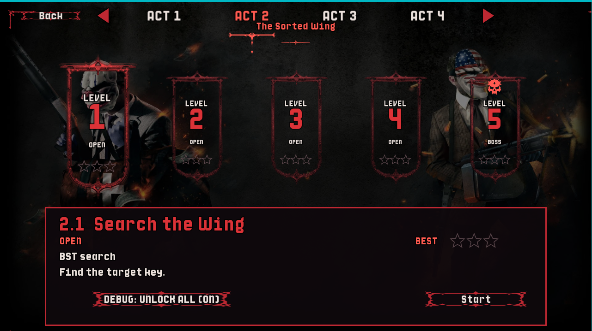

**Figure 3.** Briefing for level 2.3, BST deletion.

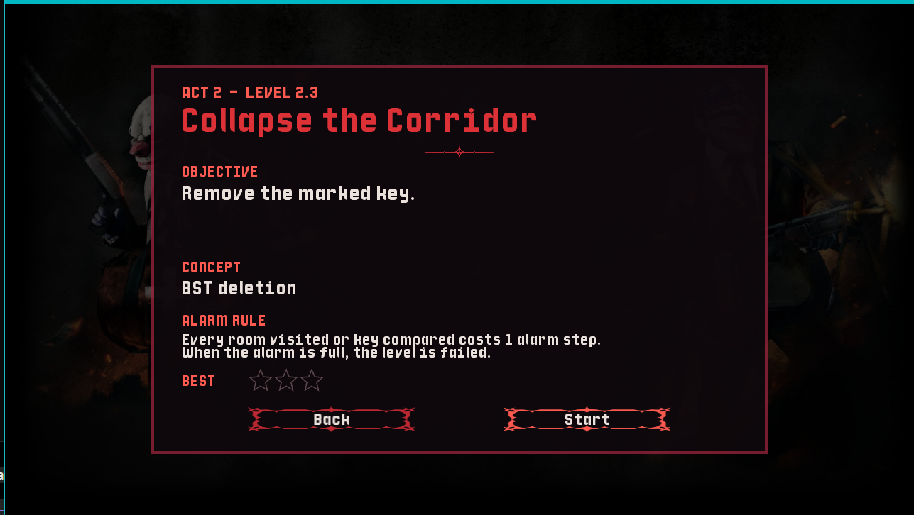

**Figure 4.** Sandbox, BST tab.

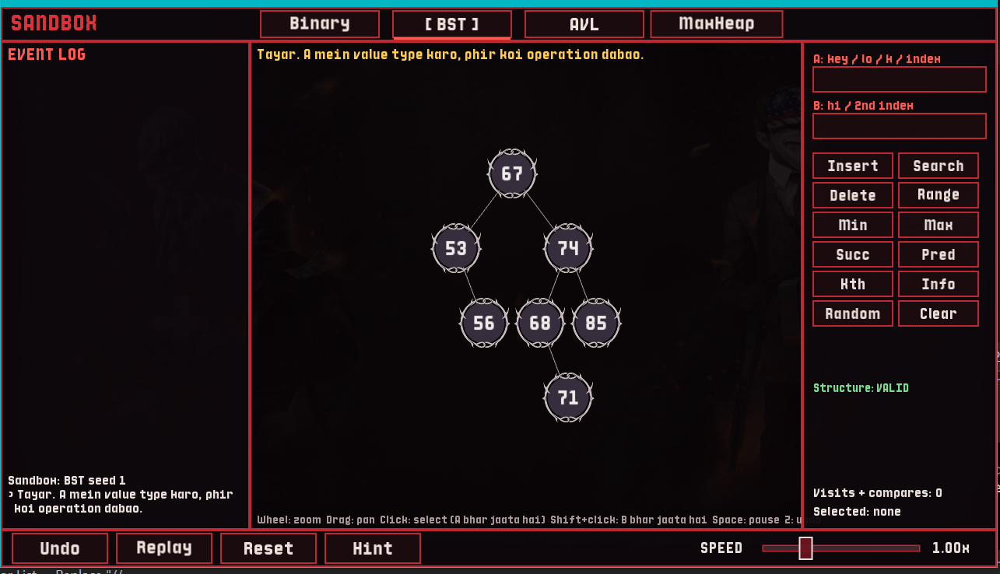

**Figure 5.** Result screen, level 1.1. Three stars were awarded. The Steps field shows the number of model submissions, not the per-room alarm count. See Section 11.

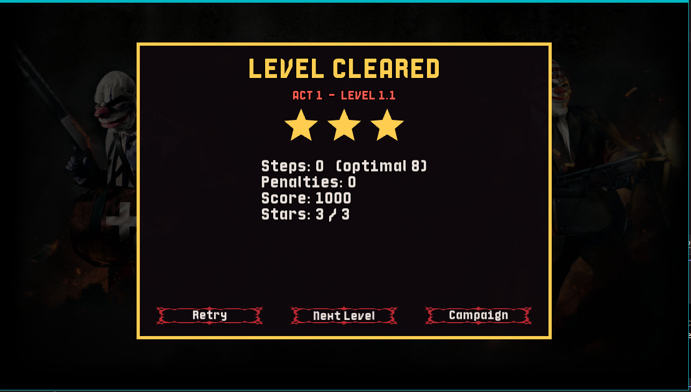

**Figure 6.** Endless mode.

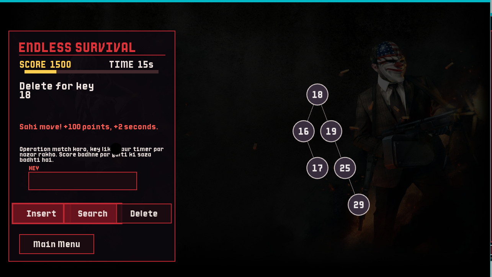

**Figure 7.** Local leaderboard.

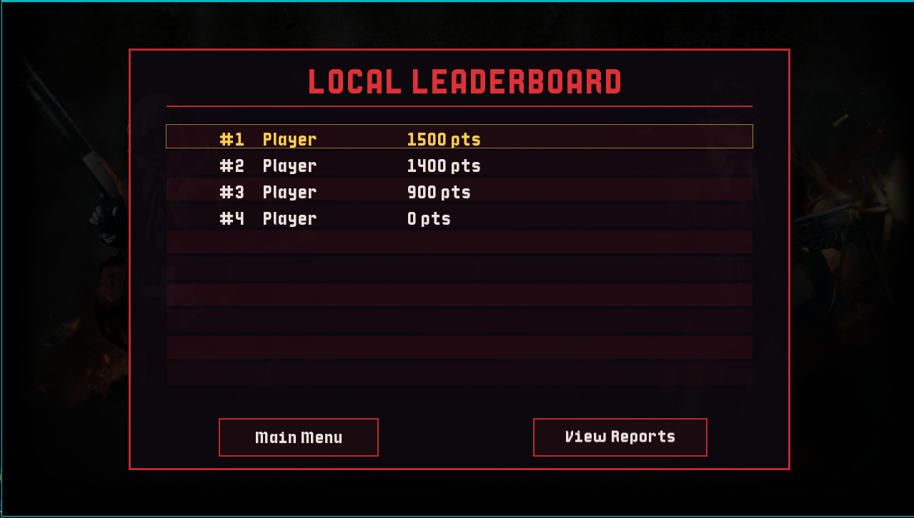

**Figure 8.** Settings.

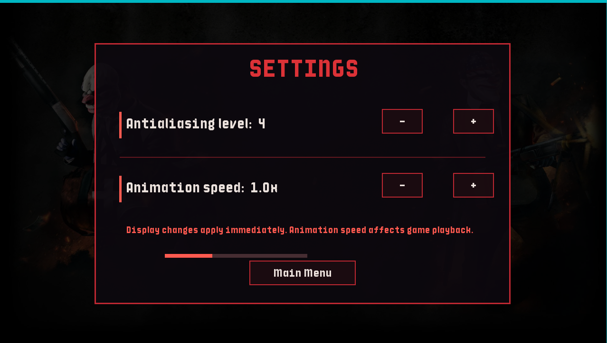

**Figure 9.** Level 3.2 (single repair). The pivot is room 50 and the balance badges show the imbalance. The event log records the LL rotation.

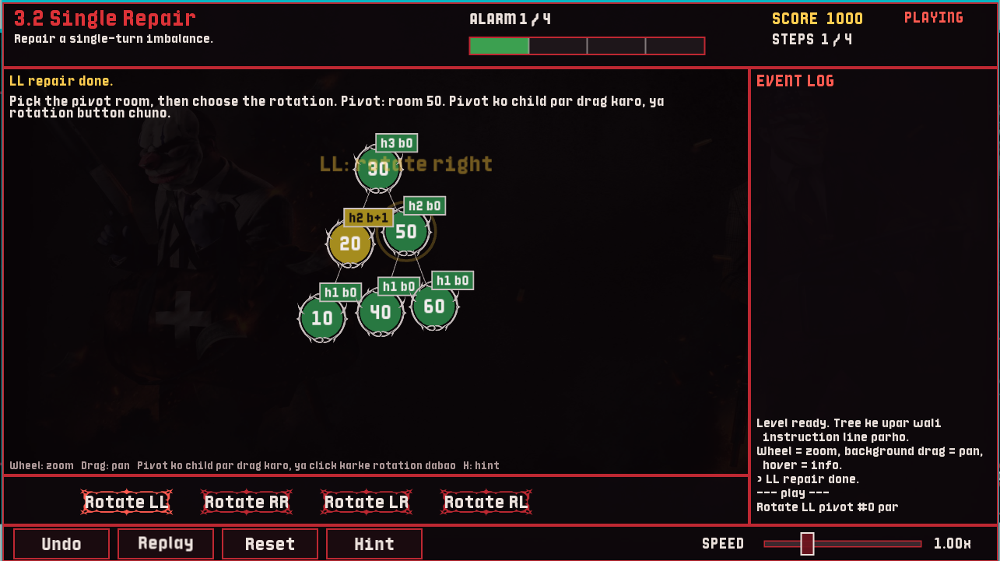

**Figure 10.** Level 2.3 (BST deletion). The player types the target key (4) into the KEY field and chooses a delete case. The event log shows the search comparisons and the unlink of room #8.

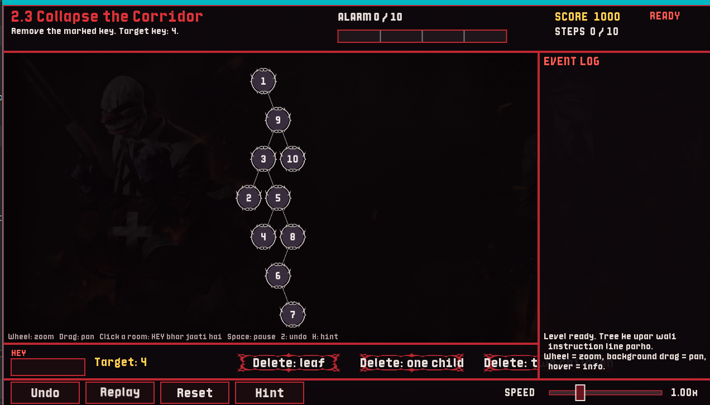

---

## 8. AVL Rotation Demonstrations

An AVL insertion rebalances the tree automatically, so a valid tree never needs a manual rotation. The sandbox rotation buttons apply a rotation to whichever room is selected, even when the result is unbalanced. The validator then reports the tree as invalid. The captures below show the rotation as logged. Each one should be read with that in mind.

**LL.** The imbalance is on the left side of the pivot, and one right rotation fixes it. The level 3.2 capture in Figure 9 shows the LL repair with pivot room 50.

**RR.** Figure 12 shows the sandbox after the RR rotation on pivot #3. The event log records `Rotate RR pivot #3` and `RR: left rotation at the pivot.` The structure badge reads VALID.


**Figure 12.** Sandbox, AVL tab, RR rotation applied to pivot #3.

**LR.** The imbalance bends at the child, so the child is rotated left first and the pivot is rotated right second. Figure 13 shows the log entry `LR: left rotation on the child, then right rotation at the pivot.`

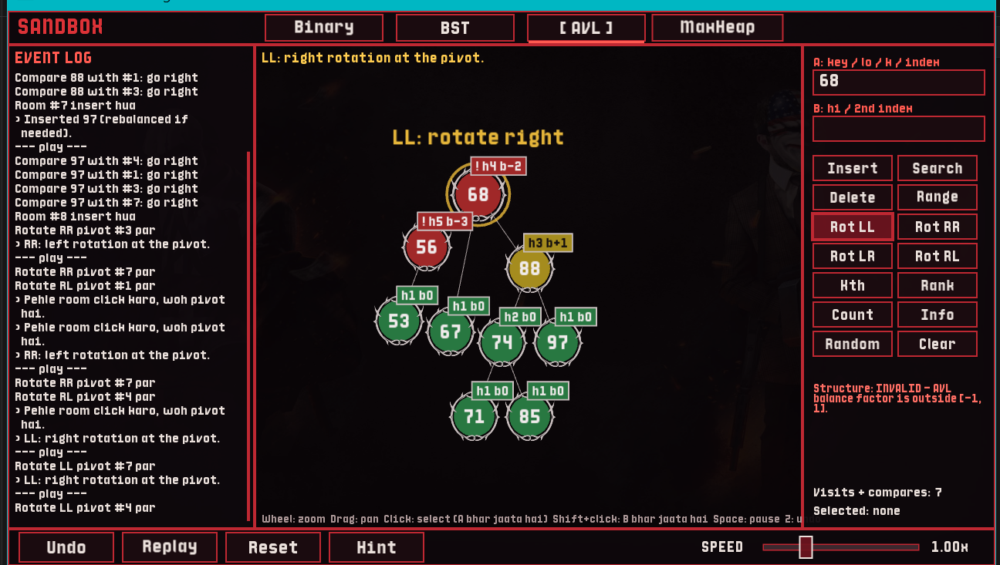

**Figure 13.** Sandbox, AVL tab, LR rotation. The capture was taken while the animation was still running.

**RL.** The mirror case: the child is rotated right first, then the pivot is rotated left. Figure 14 shows the log entry `RL: right rotation on the child, then left rotation at the pivot.` The structure badge reads INVALID in this capture, because earlier manual rotations in the same session had already left the tree unbalanced.

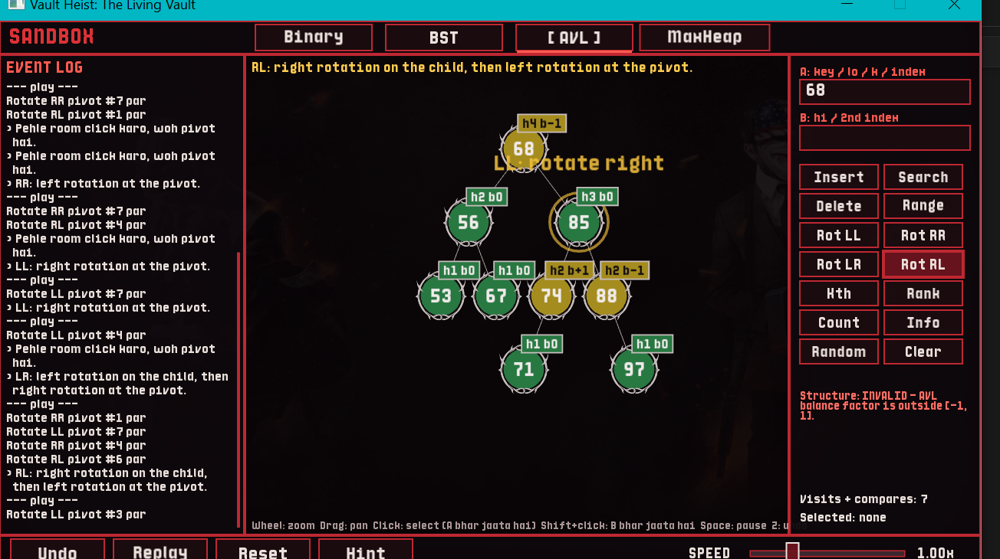

**Figure 14.** Sandbox, AVL tab, RL rotation. The capture was taken while the animation was still running, and the tree was already invalid from earlier manual rotations.

---

## 9. Heap Demonstrations

**Figure 15.** Level 4.1 before construction. The array 85, 37, 38, 78, 84, 91, 26, 85, 10, 90, 64, 36 is not yet a max heap, because index 2 (value 38) has a child at index 5 (value 91). Bottom-up construction repairs this.

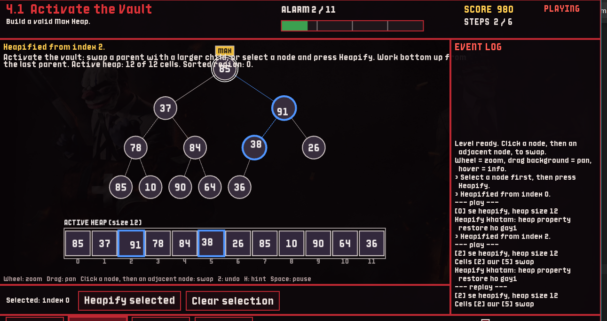

**Figure 16.** Level 4.2 after Heapify from index 0, repairing a disturbed root. The event log shows the heapify steps and the swaps that move the value 92 to the root. The capture was taken during a swap.

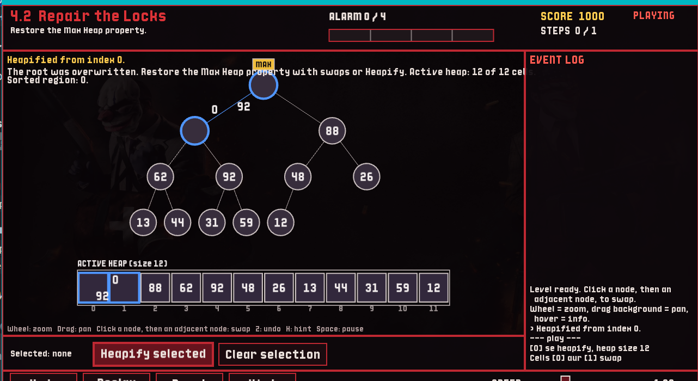

**Figure 17.** Level 4.3 during Extract Max. The maximum 99 has moved to cell 13 and is marked as sorted. The new root 27 is then sifted down. The capture was taken during the sift.

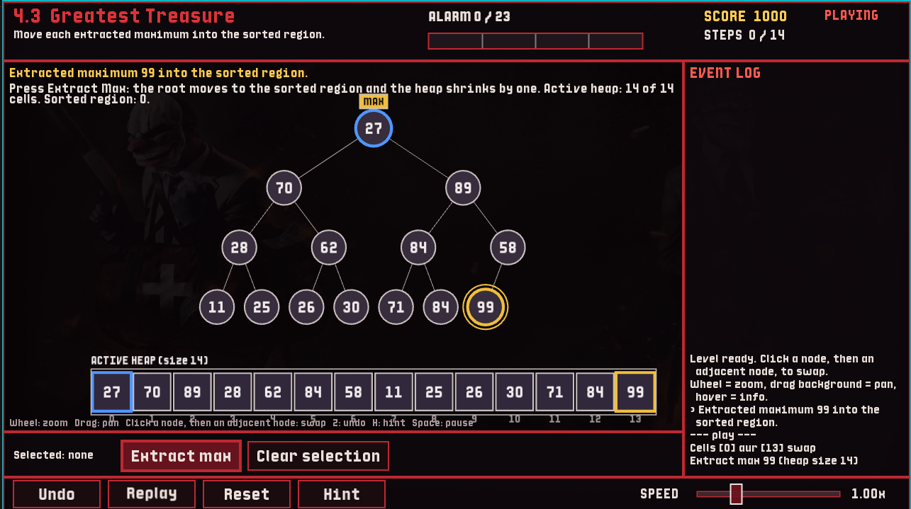

**Figure 18.** Level 4.5 during bottom-up construction over all 16 cells. The event log shows the heapify calls from index 7 down to index 3.

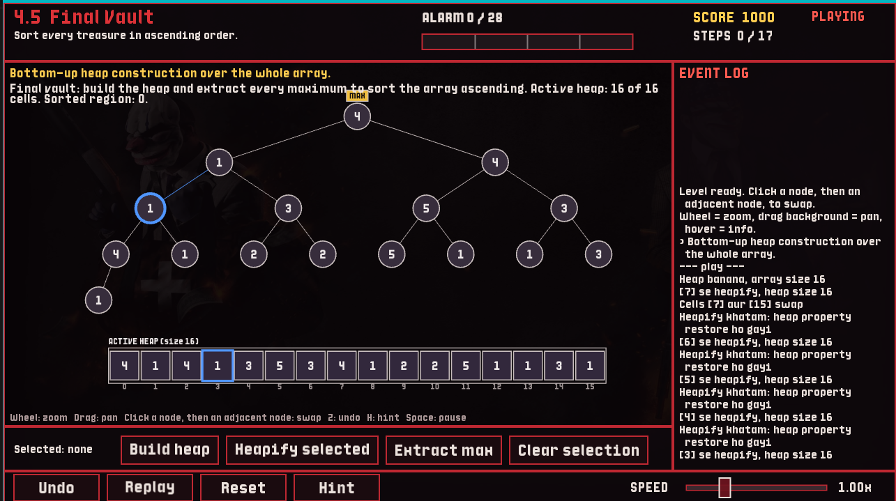

The completion badge, "Final Vault Unlocked", appears on the Result screen after level 4.5 is cleared, and the sorted array is shown there.

---

## 10. Work Division

| Member | Student ID | Responsibility |
|---|---|---|
| P1 (backend) | 25I-3148 | Model layer (`model/`): BinaryTree, BST, AVLTree, MaxHeap, sorts, validator, serializer, event log, node pool. Game logic (`game/`): level loading and generation, GameSession, scoring, save and leaderboard, JSON parser. Tests (`tests/`), benchmarks (`benchmarks/`), console demo (`console/`). Complexity analysis, test report and benchmark report. |
| P2 (GUI) | 25I-3016 | GUI layer (`gui/`): every screen, widgets, renderer, layout engine, animation controller, UI manager and assets. Level screen, heap level screen and sandbox integration. Level-design documentation, GUI screenshots and the level guide. |
| Shared | both | `contracts/` (interfaces agreed by both members), `docs/` (this report) and `README.md`. |

Both members contributed to the shared contracts and to this report. Each member must be able to explain the whole codebase at the viva, not only their own part.

---

## 11. Limitations and Future Work

- **Traversal alarm cost.** In the current build the traversal levels (1.1) send the picked rooms to the model as one submission, so the model charges no per-room alarm step. The result screen therefore shows fewer steps than rooms visited (Figure 5). Future work is to charge each pick in the model when it is made.
- **Sandbox rotations are unchecked.** The sandbox lets the user apply any rotation to any room. The validator then reports the tree as invalid, as shown in Figure 14. Level play does not allow this, because each level checks the rotation against the correct case.
- **Undo uses full snapshots.** This is correct but uses more memory than necessary. Inverse events, which the event model already supports, are the planned improvement.
- **The BST is not self-balancing.** The Act 2 boss level shows why balancing is needed.
- **Timings come from one machine and one compiler.** They show trends, not absolute speeds. The sorted BST search time, for example, varied between runs by more than a factor of seven, so only the comparison counts should be quoted as results.
- **Large heaps.** The heap view places nodes by index, so a very large heap becomes hard to read when zoomed out.
- **Level 1.1 and 1.2 checks** compare the final submission with the expected answer, not each pick as it is made. A stronger design would validate every pick at the moment it is made.

---

## 12. Conclusion

The project implements four data structures from scratch, connects them to an animated game, and measures their performance. The benchmarks match the expected growth rates. A sorted BST degrades to linear height, while the AVL tree keeps height and search cost logarithmic. Heap construction is O(n), and Heap Sort uses O(n log n) comparisons with constant auxiliary space. Insertion sort's quadratic behaviour is measured directly at n = 10,000. The layered architecture keeps the model independent of the GUI, so each part can be tested and benchmarked separately.

---

## Appendix A: Build and Run

See `README.md` in the project root for the build commands, the controls and the list of runtime files.

- **Game:** run from `DS-Project`, the folder that contains `assets/` and `levels/`.
- **Model tests:** run from `DS-Project`, the same folder as the game.
- **Benchmarks:** `.\bench.exe --no-events`.

## Appendix B: Viva Preparation

**Both members:**
- Explain the event pipeline from input to animation, and why the model never includes SFML.
- Explain the complexity of each operation in Section 4, and the difference between average and worst case for the BST.
- Explain why ids are stable and why removed nodes are marked dead rather than freed.

**P1 (backend) should be ready to explain:**
- The four AVL rotations, and why LR and RL need two rotations.
- The three BST delete cases, and why the two-child case uses the inorder successor.
- Bottom-up heap construction and why it is O(n), and one Extract Max step with the root and last-element swap.
- Why insertion sort's comparison count on reverse input is exactly n(n − 1)/2.
- How the benchmark separates build counts from Heap Sort counts.

**P2 (GUI) should be ready to explain:**
- Why `AnimationController` plays events in batches, and why snapshots are taken at specific points for each event type.
- Why the HUD numbers come from `ActionResult` and not from GUI calculations.
- How `HeapLevel` keeps the tree view and array view synchronised.
- How a click on the canvas becomes a `PlayerAction`.

---

## List of Figures

| Figure | Content | Section |
|---|---|---|
| 1 | Main menu | 7.3 |
| 2 | Campaign map | 7.3 |
| 3 | Briefing, level 2.3 | 7.3 |
| 4 | Sandbox, BST | 7.3 |
| 5 | Result, level 1.1 | 7.3 |
| 6 | Endless mode | 7.3 |
| 7 | Leaderboard | 7.3 |
| 8 | Settings | 7.3 |
| 9 | Level 3.2, LL repair | 7.3, 8 |
| 10 | Level 2.3, BST deletion | 7.3 |
| 12 | Sandbox, RR rotation | 8 |
| 13 | Sandbox, LR rotation | 8 |
| 14 | Sandbox, RL rotation | 8 |
| 15 | Level 4.1, before construction | 9 |
| 16 | Level 4.2, heapify | 9 |
| 17 | Level 4.3, extract maximum | 9 |
| 18 | Level 4.5, bottom-up construction | 9 |
